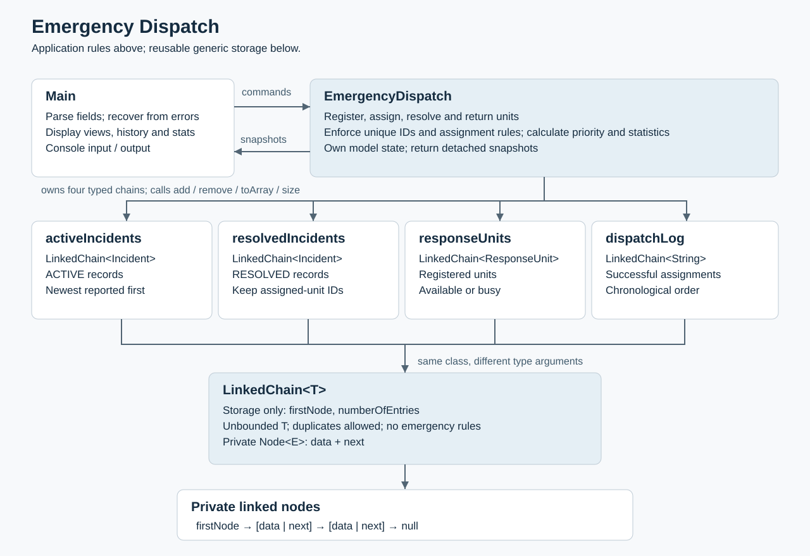

# Emergency Dispatch — Deliverable 4

CS 2114 · Project 2: Building for Reuse · Fall 2026

**Public repository:** https://github.com/nimai-garg/CS2114-Project-2

Emergency Dispatch is a Java console simulation for reporting emergencies, viewing incidents and response units, assigning units, resolving incidents, and returning units to service. The same generic `LinkedChain<T>` stores `Incident`, `ResponseUnit`, and assignment-history `String` entries. There are no type-specific chain implementations or `java.util.LinkedList` collections.

## Compile, run, and test

Requirements: **JDK 17 or newer**. No Maven or Gradle is required. Run commands from the repository root.

### macOS / Linux

```sh
sh scripts/build.sh
sh scripts/run.sh
sh scripts/test.sh
```

The scripts use `JAVA_HOME` when set, otherwise the JDK on your PATH. They also detect Homebrew Java on macOS. If Java cannot be found, set `JAVA_HOME` to your JDK installation. The program itself has no external dependencies. Tests use **JUnit 4.13.2** and **Hamcrest Core 1.3**; the test script downloads them from Maven Central into ignored `.deps/` on its first run. Later runs work offline. For an offline first run, set `JUNIT_JAR` and `HAMCREST_JAR` to existing copies of those jars.

Both source and test compilation enable all compiler warnings and treat warnings as errors. The test script discovers and runs every `*Test.java` file. The final suite contains **39 passing JUnit tests**. GitHub Actions runs the same suite and the scripted demo on pushes and pull requests.

### Eclipse / Visual Studio Code

The existing Eclipse project files remain supported. Import the repository as an existing Java project, use a JDK 17+ runtime, and ensure the build path includes **JUnit 4**. Run `src/emergencyDispatch/Main.java` as a Java application. Run the entire `test` folder as JUnit tests. In VS Code, use the Java extensions' **Run** action on `Main` and **Testing** view, or the terminal commands above.

### Manual compilation (including Windows)

Create `build/classes` and `build/test-classes`. With a JDK on PATH:

```sh
javac --release 17 -encoding UTF-8 -Xlint:all -Werror -d build/classes src/emergencyDispatch/*.java
java -cp build/classes emergencyDispatch.Main
javac --release 17 -encoding UTF-8 -Xlint:all -Werror -cp "build/classes:.deps/junit-4.13.2.jar:.deps/hamcrest-core-1.3.jar" -d build/test-classes test/emergencyDispatch/*.java
java -cp "build/classes:build/test-classes:.deps/junit-4.13.2.jar:.deps/hamcrest-core-1.3.jar" org.junit.runner.JUnitCore emergencyDispatch.LinkedChainTest emergencyDispatch.IncidentTest emergencyDispatch.ResponseUnitTest emergencyDispatch.EmergencyDispatchTest emergencyDispatch.MainTest
```

On Windows, use **`;` instead of `:` inside the quoted classpaths**. If the shell does not expand `*.java`, supply the Java filenames explicitly. Download the two jars from the Maven Central URLs in `scripts/test.sh`, or run tests using the IDE's JUnit 4 library.

## Playing the simulation

Enter **one command per line**, using the literal `|` character between fields. Commands and enum names ignore case; surrounding field whitespace is trimmed. IDs are integers from **0 through 2147483647**. Locations must be nonblank and cannot contain `|`.

```text
unit|10|FIRE_RESCUE
incident|1|FIRE|Main Street|HIGH
view
priority
assign|1|10
resolve|1
return|10
history
stats
quit
```

| Command | Behavior |
| --- | --- |
| `unit\|ID\|TYPE` | Register a response unit. |
| `incident\|ID\|TYPE\|LOCATION\|SEVERITY` | Report an active, unassigned incident. |
| `view` | List active incidents, all units with availability, and resolved incidents. |
| `assign\|INCIDENT_ID\|UNIT_ID` | Assign an available unit to an active, unassigned incident. |
| `resolve\|ID` | Move an incident into resolved history; its unit stays busy. |
| `return\|ID` | Make a unit available after it no longer serves an active incident. |
| `priority` | Show the highest-severity active incident; ties use smaller incident ID. |
| `history` | Show successful assignments in chronological order and resolved incident details. |
| `stats` | Show active/resolved totals, successful dispatch count, and resolved counts by emergency type. |
| `help` / `quit` | Show command help / exit. End of input also exits. |

**Incident types:** `FIRE`, `HOSTAGE`, `MEDICAL`, `DRUG_TRADE`, `MISSING_PERSONS`, `CONTAMINATION`, `BOMB`, `ROAD_ACCIDENT`, `THEFT`.

**Unit types:** `FIRE_RESCUE`, `EMT`, `POLICE`, `SWAT`, `SEARCH`, `HAZMAT`.

**Severity:** `LOW`, `MEDIUM`, `HIGH`, `CRITICAL`, in increasing urgency.

Malformed fields, blank IDs/locations, invalid enum values, negative IDs, integer overflow, and extra/missing fields produce an error and allow another command. Missing/resolved incidents, missing/busy units, duplicate IDs, repeated assignments, and premature returns are rejected without changing stored state. Resolving an unassigned incident is allowed. Returning an already available registered unit is safe and succeeds.

The user chooses the appropriate response-unit type. Automatic type compatibility/recommendations and difficulty levels were dropped from the final scope. Priority includes assigned incidents because they remain active until resolved. A unit can serve multiple incidents over time, but only one active incident at a time. Historical assignments retain the unit ID after the unit returns to service.

## System diagram and reuse



[Open the system diagram](docs/system-diagram.svg) · [PNG version for slides](docs/system-diagram.png). `Main` parses input and presents results; `EmergencyDispatch` owns application rules; `Incident` and `ResponseUnit` hold model state. `LinkedChain<T>` and its private `Node<E>` own storage only. The four dispatcher fields are `activeIncidents: LinkedChain<Incident>`, `resolvedIncidents: LinkedChain<Incident>`, `responseUnits: LinkedChain<ResponseUnit>`, and `dispatchLog: LinkedChain<String>`.

A linked chain fits the small, ID-managed collections: adding/removing entries does not shift an array, and domain identity does not depend on position. Searches are linear; a map would be a better choice for very large ID-indexed workloads. The chain itself allows duplicates and does not sort entries. The dispatcher enforces unique IDs and calculates priority. Keeping those policies outside storage allows reuse with unrelated types.

## Reflection

**Specification to prototype:** `Main` supplied the console interface. `Incident.getAssignedUnitId()` matched the specification while `getUnitId()` remained for compatibility. Collection getters changed from returning stored chains to returning separate chains. The priority stretch goal and a `LinkedChain<String>` assignment log were added. The prototype searched arrays obtained through `toArray()` once per search, avoiding repeated indexed linked-list traversal. See the [Deliverable 3 commit](https://github.com/nimai-garg/CS2114-Project-2/tree/74de0ab23d99c7e1eba5998ae4b96a70e039c2c4) for the submitted prototype and its original reflection.

**Prototype to final:** The prototype's separate chains still shared mutable model objects. A caller could resolve an incident through a finder or set a busy unit available, bypassing `EmergencyDispatch`. Registration, finders, collection queries, and priority now copy their models. Private lookup methods access owned objects for legitimate dispatcher actions. `Incident` and `ResponseUnit` are final so subclasses cannot override the copy/validation behavior. Public model mutators remain usable on standalone objects and snapshots; changes to snapshots do not change the dispatcher. Call a query again to see later updates.

`EmergencyDispatch.getResolvedCount(IncidentType)` and `getDispatchCount()` complete statistics. `Main` adds `stats`, resolved-history display, `help`, case-insensitive parsing with a fixed locale, and clearer ID errors. `EmergencyDispatchTest` now attempts mutations through input objects, finders, collections, and priority; `MainTest` adds statistics, overflow, extra-field, case, and locale cases. Build/test scripts, continuous integration, the diagram, and review documentation make the final repository reproducible. These final changes originated in the GenAI-assisted implementation requested by Nimai; they are not claims of completed teammate review.

**LinkedChain changes:** The course-provided implementation is unchanged from Deliverable 3. Its only earlier adaptation was the `package emergencyDispatch;` declaration. The unbounded `T` needs no comparison interface because storage uses equality, not incident-specific rules. `add(T)`, `get(int)`, and typed array conversion enforce element types without raw collections or unchecked casts. Empty removal returns `null`; missing removal returns `false`; invalid retrieval throws `IndexOutOfBoundsException`, as specified.

**Unknowns resolved:** The provided generic node/API settled storage behavior; a nullable assigned-unit ID connects models; severity plus ID defines deterministic priority; detached snapshots now protect ownership; resolved chains and assignment messages support statistics/history. No MVP feature is knowingly incomplete. Persistence, multi-user access, response-time calculations, compatibility recommendations, and difficulty rules are outside the final scope. All data is in memory and resets when the program exits.

**Complexity:** With `n` entries across the relevant chains, searches/actions, priority, snapshots, history copying, and resolved-count queries are O(n); `getDispatchCount()` is O(1). Array snapshots use O(n) temporary space to preserve linear traversal through the chain's public API. Model construction/copy/display also depends on location length; other model operations are O(1). See [contracts, complexity, and test coverage](docs/contracts-and-tests.md) for method-level details and validation responsibilities.

## Next Steps

Repository implementation is complete for the defined final scope. **Priority** and **history/statistics** are implemented; **recommendations** and **difficulty levels** are dropped. The existing tests and new ownership/statistics tests pass.

The team still needs to review the code together and prepare the separate slide deck and oral presentation. The deck must put the public repository URL on its title slide and be uploaded to Canvas; there is no separate writeup or zip submission. The [demo guide](docs/demo.md) provides a repeatable repository demonstration. Team members should personally run it and understand the contracts before the grading session. The earlier proposed review assignments remain responsibilities, not claims of completed work.

## Attribution

The original attribution and Git history identify the existing contributions below. **Codex (GenAI)** generated the final changes and ran automated verification at Nimai's request. No human review, manual testing, or contribution by another member is asserted unless recorded in the earlier work. Each class and test file has its own row.

| Class or test file | Contributors and contribution |
| --- | --- |
| `LinkedChain.java` (including private `Node<E>`) | CS 2114 Staff: supplied implementation. Jiho: imported. No final implementation changes. |
| `Incident.java` | Mayank: original model. Codex: prototype specification getter; final detached-copy behavior and final-class protection. |
| `IncidentType.java` | Mayank: implemented. Abdullah: enum design in specification. Unchanged for final. |
| `IncidentStatus.java` | Mayank: implemented. Abdullah: enum design in specification. Unchanged for final. |
| `Severity.java` | Mayank: implemented. Abdullah: enum design in specification. Unchanged for final. |
| `UnitType.java` | Mayank: implemented. Abdullah: enum design in specification. Unchanged for final. |
| `ResponseUnit.java` | Codex: prototype implementation; final detached-copy behavior and final-class protection. |
| `EmergencyDispatch.java` | Codex: prototype implementation; final state ownership, statistics, and API documentation. |
| `Main.java` | Jiho: initial scaffold. Codex: prototype console; final help, statistics/history display, and input handling. |
| `LinkedChainTest.java` | Codex: wrote and executed prototype tests; reran for final. |
| `IncidentTest.java` | Codex: wrote and executed prototype tests; reran for final. |
| `ResponseUnitTest.java` | Codex: wrote and executed prototype tests; reran for final. |
| `EmergencyDispatchTest.java` | Codex: wrote prototype tests; added and executed final ownership, statistics, priority, ID-boundary, and repeated-workflow tests. |
| `MainTest.java` | Codex: wrote prototype tests; updated final banner and added/executed statistics, case, overflow, extra-field, and locale tests. |

Nimai Garg requested and directed the prototype/final assistance and authored the existing repository commits. Mayank, Nimai, Abdullah, and Jiho's specification contributions are recorded in Deliverable 2; design contributions do not imply authorship of every implementation file. The prototype proposed review responsibilities for all four members, which the team should confirm as they complete them.

**GenAI use:** Assistance included substantial source and test generation, edge-case analysis, documentation, scripts, continuous integration, and diagram creation, as well as compiling/running tests and the scripted demo. This is broader than the prototype README's brief note about test execution and README drafting. Automated test success does not demonstrate that every teammate has reviewed or understood the implementation. The presentation's ethics reflection should describe the team's actual verification and learning, including any remaining reliance on generated work.

Other repository artifacts: Codex drafted/revised this README, `docs/`, `scripts/`, `.github/workflows/java.yml`, and `.gitignore` in this final session. The local IDE's `.project` changes are left as found.
