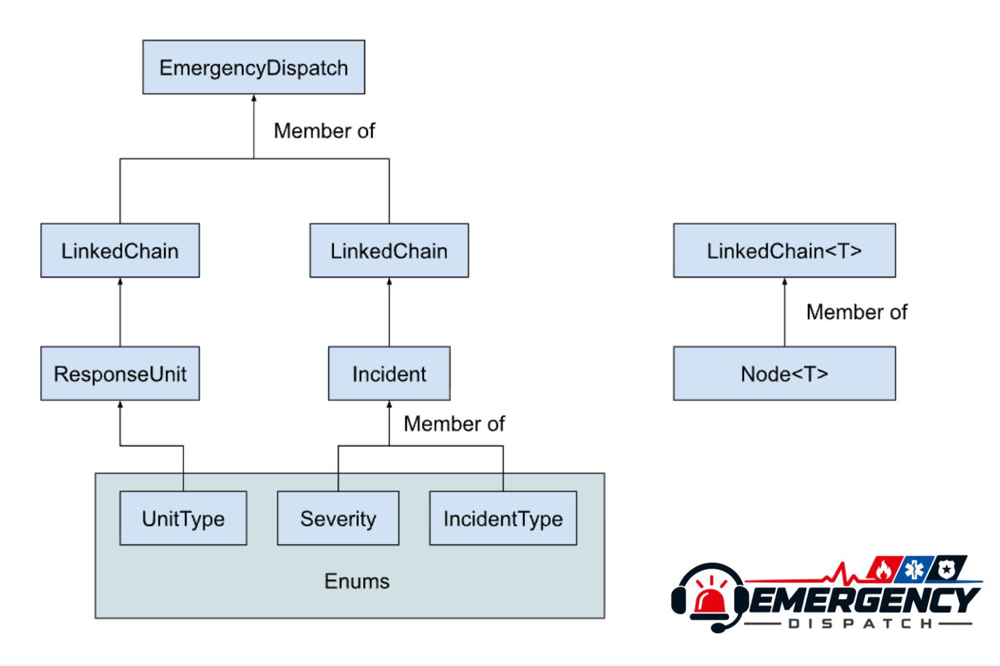

# Emergency Dispatch

CS 2114 · Project 2 · Deliverable 4

Repository: https://github.com/nimai-garg/CS2114-Project-2

A Java console simulation for reporting emergencies, assigning response units, resolving incidents, and returning units to service. One generic LinkedChain stores Incident, ResponseUnit, and assignment-history String entries.

## System Design

## Run

Requires **Java 17 or newer**.

In **VS Code**, open the repository and select **Run** above the main method in [Main.java](src/emergencyDispatch/Main.java). In **Eclipse**, import the existing project and run Main as a Java application.

For a terminal with a JDK on PATH:

~~~sh
mkdir -p bin
javac --release 17 -encoding UTF-8 -d bin src/emergencyDispatch/*.java
java -cp bin emergencyDispatch.Main
~~~

The bin folder is generated when compiling and is excluded from Git.

## Tests

The project uses **JUnit 4** and contains **60 tests**.

Regression coverage includes missing IDs in populated systems, duplicate IDs
after assignment and resolution, busy units, assignment with either chain empty,
repeated resolution after unit reuse, and chain reuse after removal or clearing.

In VS Code, open **Testing** and choose **Run All Tests**. In Eclipse, right-click the test folder and choose **Run As → JUnit Test**. If JUnit is missing, add the JUnit 4 library to the Java build path. The existing .classpath defines both source folders and the JUnit 4 container.

For terminal testing, set JUNIT_JAR and HAMCREST_JAR to the paths of your JUnit 4 and Hamcrest jars. The jars can be supplied by your IDE and do not need to be stored in this repository. After compiling the program:

~~~sh
javac --release 17 -encoding UTF-8 -cp "bin:$JUNIT_JAR:$HAMCREST_JAR" -d bin test/emergencyDispatch/*.java
java -cp "bin:$JUNIT_JAR:$HAMCREST_JAR" org.junit.runner.JUnitCore emergencyDispatch.LinkedChainTest emergencyDispatch.IncidentTest emergencyDispatch.ResponseUnitTest emergencyDispatch.EmergencyDispatchTest emergencyDispatch.MainTest
~~~

On Windows, replace the colons inside classpaths with semicolons. If your shell does not expand *.java, list the Java filenames explicitly.

## Menu

| Option | Action |
| --- | --- |
| 1 | Report an incident |
| 2 | Register a response unit |
| 3 | Dispatch a unit |
| 4 | Resolve an incident |
| 5 | Return a unit to service |
| 6 | View the dispatch board |
| 7 | View the highest-priority incident |
| 8 | View history |
| 9 | View statistics |
| 0 | Exit |

Type **menu** to repeat the options or **back** at a field prompt to cancel. Types and severity accept their displayed number or name. IDs must be nonnegative integers, and locations cannot be blank.

Invalid input is re-prompted. Duplicate IDs, unavailable units, missing/resolved incidents, and premature unit returns are rejected without changing stored state. Resolve an incident before returning its unit. Priority uses severity, then smaller incident ID. History retains successful assignments; statistics show resolved counts by emergency type.

All data is held in memory for the current session. Recommendations and difficulty levels are outside the final scope.

## System diagram

Main handles input and display. EmergencyDispatch owns dispatch rules and returns separate model copies to protect stored state. LinkedChain and its private Node handle storage through a generic public API; the dispatcher holds active/resolved incident chains, a unit chain, and an assignment-history chain.

## Attribution

| Class or test file | Contribution |
| --- | --- |
| LinkedChain.java, including Node | CS 2114 Staff supplied the implementation; Jiho imported it. Comments were shortened; storage behavior is unchanged. |
| Incident.java | Mayank implemented the original model; GenAI added the specification getter and state-copy protection. |
| IncidentType.java | Mayank implemented it; Abdullah contributed enum design in the specification. |
| IncidentStatus.java | Mayank implemented it; Abdullah contributed enum design in the specification. |
| Severity.java | Mayank implemented it; Abdullah contributed enum design in the specification. |
| UnitType.java | Mayank implemented it; Abdullah contributed enum design in the specification. |
| ResponseUnit.java | GenAI implemented and tested the model and state-copy protection. |
| EmergencyDispatch.java | GenAI implemented and tested dispatch rules, protected snapshots, priority, history, and statistics. |
| Main.java | Jiho created the scaffold; GenAI implemented the console and numbered menu. Nimai ran live demos and directed interface revisions. |
| LinkedChainTest.java | GenAI wrote and ran the storage tests. |
| IncidentTest.java | GenAI wrote and ran the incident tests. |
| ResponseUnitTest.java | GenAI wrote and ran the unit tests. |
| EmergencyDispatchTest.java | GenAI wrote and ran workflow, validation, ownership, priority, and statistics tests. |
| MainTest.java | GenAI wrote and ran menu, input recovery, cancellation, EOF, formatting, and workflow tests. |

**GenAI use:** Assistance included source-code integration and implementation, debugging, test generation/execution, documentation, and the system diagram. Nimai directed the assistance and supplied live-demo transcripts. The table records known contributions; it does not claim additional teammate review. Attribution is retained here because Deliverable 4 requires it.
